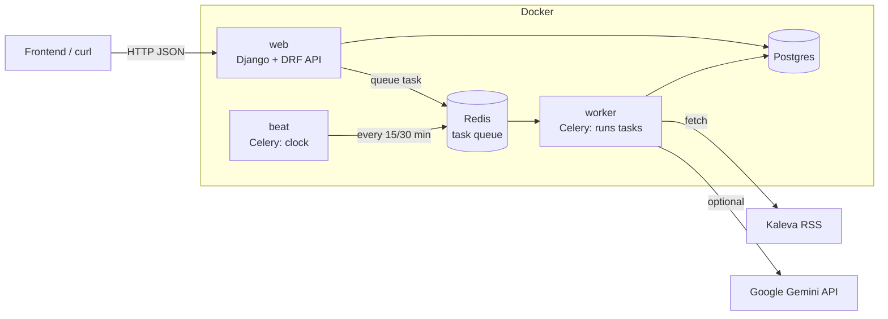
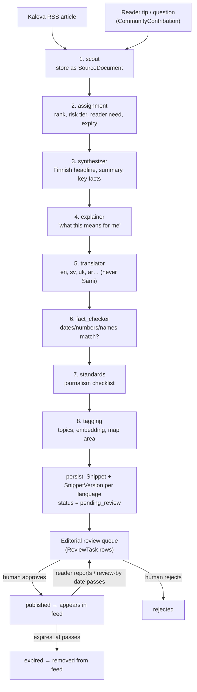
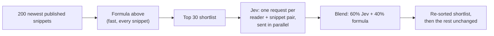

# Team guide: how this project works

This guide explains the backend: how to run it, how a news story moves from an
RSS feed to a reader's phone, and where each piece of logic lives. Read it top
to bottom once; after that, use the headings as a reference.

- **Requirements:** the FRS document (FR-1 … FR-5). FR numbers appear in code docstrings, so you can `grep FR-3.7` to find where a requirement is implemented.
- **Model contract:** [ARCHITECTURE.md](ARCHITECTURE.md) lists every model and field name.

---

## 1. What we are building

A local news app for a community (we seed **Oulu**). AI agents read local news
sources such as Kaleva's RSS feeds, write short "snippet" cards in Finnish, explain
what each story means for newcomers, students and seasonal workers, and translate
it. **Nothing reaches readers until a human editor approves it.** Around that
core there are community boards, crowd-sourced fact-check notes, and a sports
prediction game that uses virtual points only.

This repo is the **backend only**: a REST API with no web pages for readers.
A frontend (the swipeable feed) still needs to be built against
`http://localhost:8000/api/`.

---

## 2. Getting it running

### Option A: Docker (recommended, same for everyone)

You need Docker Desktop (Mac/Windows) or Docker Engine with the compose plugin (Linux).

```bash
git clone <repo> && cd junction-oulu-2026
docker compose up --build -d
```

That's all. On every start, a one-shot `setup` container migrates the database,
loads the demo data and creates an admin user, then exits. The other containers
start after it finishes.

| URL | What |
|---|---|
| http://localhost:8000/ | **Dev UI** (`backend/frontend/index.html`): feed, compare two readers, profile, editor queue, AI newsroom, markets. |
| http://localhost:8000/api/docs/ | Interactive API docs (Swagger). Try any endpoint here. |
| http://localhost:8000/admin/ | Django admin. Log in with `admin@example.com` / `admin`. |

Demo accounts created by `bootstrap` (local dev only; the dev UI has one-click buttons for them):

| Account | Password | Profile |
|---|---|---|
| `admin@example.com` | `admin` | Superuser, can review everything |
| `newcomer@example.com` | `demo-reader` | Newcomer who arrived 5 days ago; interests housing, work, health, services |
| `fan@example.com` | `demo-reader` | Long-time resident; interests sports, culture, events |

**Try the whole flow in the dev UI:**
1. Click **Editor (admin)**, then go to **AI newsroom** → *Run pipeline*.
2. Go to **Editor queue** and approve a few snippets. Approving an editor task publishes the Finnish version. For English, switch the filter to *Translation tasks* and approve the `en` ones too.
3. Go to **Compare readers** → *Load both feeds*. With a `TYPESAFE_API_KEY` set, the two readers get different orders, and each card shows Jev's reasons.

Useful commands (or use `make up`, `make logs`, `make down`; run `make help` for the full list):

```bash
docker compose logs -f web worker      # watch what's happening
docker compose exec web python manage.py run_pipeline oulu   # run the AI newsroom once
docker compose exec web python manage.py shell               # Python shell with Django loaded
docker compose down                    # stop (keeps data)
docker compose down -v                 # stop AND wipe the database
```

You only need `.env` to change settings (for example to add a Gemini API key):
`cp .env.example .env`, edit it, then run `docker compose up -d` again.

### Option B: Local Python, no Docker

Needs Python 3.13. This uses SQLite, and tasks run inline, so you don't need
Postgres or Redis.

```bash
cp .env.example .env
python3 -m venv .venv
.venv/bin/pip install -r backend/requirements.txt     # Windows: .venv\Scripts\pip ...
cd backend
../.venv/bin/python manage.py bootstrap                # migrate + demo data + admin user
../.venv/bin/python manage.py runserver
```

Run the tests with `cd backend && ../.venv/bin/pytest` (or `make test`).

### Troubleshooting

| Symptom | Cause / fix |
|---|---|
| `address already in use` on 5433 / 6380 / 8000 | Another program uses that port. Change the left-hand number under `ports:` in `docker-compose.yml`. |
| `setup` exited with an error | `docker compose logs setup` shows why. Usually a migration problem after pulling new code; `docker compose down -v` gives you a fresh database. |
| `run_pipeline` reports 0 snippets | The scout skips articles it has already ingested. Wait for new articles, or `docker compose down -v` to start over. |
| Translations look like `[en] Finnish text…` | No `GEMINI_API_KEY` is set, so the offline stub LLM is running (see §5). |
| Newsroom runs fine but text still looks stubbed, with a key set | The run's errors (admin → Agents → Agent runs → state) show the Gemini error. Usually a wrong key or `LLM_MODEL` name; after editing `.env`, run `docker compose up -d`. |

Ports on your machine: API **8000**, Postgres **5433** (user/pass/db `junction`), Redis **6380**.

---

## 3. The big picture



- **web** answers HTTP requests. It never runs the slow AI pipeline itself; it queues a task.
- **beat** is a clock. It queues scheduled jobs from `backend/config/celery.py`:
  - ingest news: every 30 min
  - expire old snippets: every 15 min
  - settle finished sports events: every 5 min
- **worker** picks jobs off Redis and runs them (the LangGraph pipeline, expiry, settlement).
- **Postgres** stores everything. **Redis** is only the job queue.

### Code layout

```
backend/
  config/            settings.py (all config), urls.py (routes), celery.py (schedule)
  apps/
    common/          shared enums (languages, risk tiers…), base model, permissions, bootstrap command
    accounts/        users, profiles, onboarding, roles
    communities/     communities, posts, contributions, sources, glossary, context library
    feed/            snippets, per-language versions, the feed API, ranking
    agents/          the LangGraph AI newsroom
    editorial/       human review queue, approval rules, audit log, corrections
    notes/           Community Notes
    markets/         prediction markets and the virtual-points ledger
```

Every app follows the same pattern, so once you know one you know them all:

| File | Holds |
|---|---|
| `models.py` | Database tables |
| `services.py` (or `services/`) | **Business logic.** Plain Python functions. Put rules here, not in views. |
| `serializers.py` | Model ↔ JSON |
| `views.py` | HTTP endpoints. Thin: validate input, call a service, return JSON. |
| `urls.py` | Mounted at `/api/<app>/` |
| `admin.py` | Django admin screens |
| `tests/` | pytest tests |

Apps refer to each other's models by string (`"feed.Snippet"`) to avoid circular imports.

---

## 4. The life of a news snippet (the core flow)

This is the most important section. Follow one story from Kaleva to a reader:



Step by step, with the code location:

1. **Trigger.**
   - Normally: `beat` queues `ingest_all_communities` every 30 min, which queues `ingest_and_run(community_id)` for each community (`apps/agents/tasks.py`).
   - Manually: `manage.py run_pipeline oulu`, or `POST /api/agents/runs/` as staff.
   - Each run creates an `AgentRun` row.
2. **The graph runs** (`apps/agents/graph/build.py`). LangGraph passes one shared dictionary, the *state* (`graph/state.py`), through eight agent functions in a fixed order. Each agent reads what earlier agents wrote and adds its own part, and each step is saved as an `AgentStep` row, so you can see what every agent did in the admin under *Agents → Agent runs*. If one agent crashes, the error is recorded and the run continues. The fact-checker and standards agents then fail the incomplete item, which sends it to a human.
3. **Persist** (`apps/agents/services.py: persist_graph_result`):
   - For each story, it creates one `Snippet`, which holds the language-neutral data: risk tier, tags, expiry, confidence.
   - It creates one `SnippetVersion` per language, holding the text.
   - It stores the `VerificationResult` and `StandardsCheck` and calls `editorial.enqueue()`.
   - **Failed verification or low confidence bumps the risk tier to High.**
4. **Human review** (`apps/editorial/services.py`). `enqueue` creates one `ReviewTask` per required approval (see §6). Editors work through `GET /api/editorial/tasks/`, highest priority first. When the last required approval lands, `approve()` calls `publish()` automatically.
5. **Feed.** `GET /api/feed/snippets/` shows only published snippets that haven't expired, and for each one only language versions a human approved.
6. **After publishing:**
   - A reader report (`POST /api/feed/snippets/{id}/report/`) reopens the snippet with top priority, which takes it out of the feed until re-approved.
   - Past `review_by`, a "refresh" review task is created.
   - Past `expires_at`, the snippet becomes `expired`.
   - Editing a published snippet creates a public `Correction`.

---

## 5. The agents, one by one

All in `backend/apps/agents/graph/nodes/`. Each one maps to a newsroom job and has
a human counterpart who can overrule it (FR-3.6).

| # | Agent | Newsroom job | What it does | Human counterpart |
|---|---|---|---|---|
| 1 | `scout` | Reporter / tip desk | Fetches the community's `SourceFeed`s (RSS) and stores new or changed articles as `SourceDocument`. It skips duplicates by content hash, and a changed article gets `version + 1`. It also pulls open reader questions and tips, and loads the glossary and context library. | Members and editors adding tips |
| 2 | `assignment` | News desk | Scores and ranks items and keeps the top `max_items`. Reader tips get a boost, and a tip that matches an official article boosts that article. Picks reader needs (Kaleva model) and a **risk tier**, plus expiry and review-by dates. | News editor |
| 3 | `synthesizer` | Writer | Finnish headline, 2-sentence summary, 3–5 key facts. | Editor |
| 4 | `explainer` | Writer | "What this means for me" per reader situation (newcomer, student…). Background text is copied **only** from human-reviewed `ContextEntry` rows and stored in a separate `background` field. | Editor |
| 5 | `translator` | Translator | Translates into the community's languages using the `GlossaryTerm` list (Kela, Migri…). **It never writes Sámi.** For Sámi it creates an empty placeholder that a human must fill. | Native-language reviewer |
| 6 | `fact_checker` | Fact-checker | Pulls dates, times, numbers and names out of the source, the Finnish draft and every translation, and checks they match. It also back-translates each translation and compares it with the draft. Outputs pass/fail, a confidence score and a list of mismatches. | Editor resolving flags |
| 7 | `standards` | Standards editor | Runs the journalism checklist (`STANDARDS_CHECKLIST` in `apps/editorial/models.py`): sources named, AI role disclosed, correction path, ads separated, privacy. | Standards editor |
| 8 | `tagging` | – | Topic tags, an embedding vector, and a geographic bounding box. | Editor |

**Risk tiers.** The keyword rules are in `graph/text.py`:
- **High:** residence permits, health, employment, legal, safety.
- **Medium:** transport, services, events.
- **Low:** opening hours, weather.

The LLM may *raise* a tier, but never lower it below the keyword result.

### The LLM, and running without one

`graph/llm.py` gives every agent the same interface: `structured_call(prompt, Schema, fallback)`.

- **With `GEMINI_API_KEY` set** (in `.env`): it calls Google's **Gemini Flash** model (`LLM_MODEL`, default `gemini-3.8-flash`) via LangChain's `ChatGoogleGenerativeAI`. Gemini returns JSON that matches a pydantic schema (`graph/schemas.py`) using its native structured output, so nothing has to be parsed out of free text.
  - Get a key at [Google AI Studio](https://aistudio.google.com/apikey).
  - To use a cheaper or older model, set `LLM_MODEL` (e.g. `gemini-3.5-flash-lite`). Model names are listed at [ai.google.dev/gemini-api/docs/models](https://ai.google.dev/gemini-api/docs/models).
- **Without a key**: a deterministic **stub** runs each agent's `fallback` function instead:
  - Headlines come from the RSS title, facts from sentences that contain numbers, and risk from keywords.
  - "Translations" are just the Finnish text with an `[en]` prefix.

  The stub is there so the whole flow works offline, in tests and at demos without spending tokens. **For real output, set the API key.**
- If the real API errors mid-run, that agent falls back to the stub for that item, and the run continues.

To use another provider, add a wrapper class next to `GeminiLLM` in `graph/llm.py` and return it from `get_llm()`. Any LangChain chat model that supports `with_structured_output` works.

---

## 6. Editorial rules: who must approve what

All in `apps/editorial/services.py`. The pure rule is `requirements_for(tier, languages)`.

| Risk tier | Required approvals before publishing |
|---|---|
| **High** | 1 editor **and** 1 language reviewer for *each* non-Finnish version |
| **Medium** | 1 editor |
| **Low** | 1 editor, via the batch queue (`POST /api/editorial/tasks/batch-approve/`) |

- **Escalation:** failed fact-check or confidence < `AGENT_CONFIDENCE_THRESHOLD` (0.7) → treated as High, whatever the original tier.
- **Per-language publishing:**
  - The snippet goes live when the editor has approved it and the Finnish version is approved.
  - Each other language shows up in the feed only once *its own* reviewer approves it. Until then, readers of that language see the Finnish (or English) version.
- **Sámi (se, smn, sms):**
  - Always needs a language reviewer.
  - Machine-translated text can never be approved.
  - The empty placeholder can't be approved either: the reviewer writes the text and sends it as `edits` in the approve call.
  - A community editor of that community can veto by rejecting.
- **Queue order:**
  - Reports first (priority 90 + tier), then failed verification (80), failed standards (70), low confidence (60), then everything else.
  - Within each reason, higher risk comes first.
  - Reopened snippets get 100.
- **Audit:** every action (agent created, enqueued, approved, edited, rejected, published, reopened, expired) writes an `AuditLogEntry`. See `GET /api/editorial/snippets/{id}/audit/`.
- **Corrections:** editing an already-published snippet creates a `Correction`. That shows in the public `GET /api/editorial/corrections/` log and as `correction_note` on the card.
- **AI disclosure:** every card carries `ai_disclosure` with the agent roles that worked on it, the reviewer's name, the verification date, and whether the text is machine-translated.

### Roles

Roles are `UserRole` rows. Grant them in **admin → Users → (user) → User roles** inline. A role can be scoped to one language and/or one community; leave a scope empty to mean "all".

| Role | Can |
|---|---|
| `editor` | Approve/reject the whole snippet |
| `language_reviewer` | Approve a language version (set `language`) |
| `news_editor`, `standards_editor` | Defined, not yet required by the rules (see §12) |
| `community_editor` | See their community's queue; veto Sámi content |
| `admin` | Everything, incl. configuring sources/glossary/context via API |

Superusers (like the dev `admin@example.com`) pass every role check, which is handy for demos.

---

## 7. The feed

`apps/feed/`. The main endpoint is `GET /api/feed/snippets/` (`?lang=en`, `?community=oulu`, `?tag=health`, `?limit=&offset=`).

**Card payload** (one per snippet, in the reader's language):

```
id, language, headline, summary, key_facts[], explainer{situation: text}, background,
image_url, source_urls[], author, community, tags[], reader_needs[], risk_tier,
published_at, verified_at, review_status, metrics{likes,shares,bookmarks,comments},
ai_disclosure{ai_generated, roles[], reviewer, verified_at, machine_translated},
correction_note, community_notes[]   ← only notes rated Helpful
ranking{ranker, score, jev…}         ← why this card is here (see "Jev" below)
```

**Language choice:** `?lang=`, otherwise the user's `preferred_language`, then Finnish, then English. Only approved versions are used.

**Ranking** (`apps/feed/recommend.py`, FR-2.3). The newest 200 published snippets are scored, and each gets:

```
score = 0.40 × interest match      (user's interest weights vs snippet tags)
      + 0.25 × geo relevance       (member of snippet's community = 1, location inside its area = 0.7)
      + 0.20 × engagement          (read-through rate, expand taps, likes in the last 7 days)
      + 0.15 × freshness           (halves every 48 h)
```

The weights are constants at the top of the file, so tune them freely.

### Jev: AI ranking per reader

When `TYPESAFE_API_KEY` is set, [Jev](https://docs.typesafe.ai/) re-ranks the top of the feed for each signed-in reader (`apps/feed/jev.py`). Jev is TypeSafe AI's model for fast structured decisions: it doesn't write text, it returns probabilities for questions you define, in roughly 0.1–0.5 s.



Each request sends Jev a **state**: the reader's profile and the snippet. It asks four small questions about them:

| Question | Type | Weight |
|---|---|---|
| `affects_reader`: does this news directly affect this reader's life, rights, money, health or plans? | yes/no probability (Noul) | 45% |
| `matches_interests`: is it about one of their interests? | Noul | 25% |
| `needs_action`: is there a deadline, registration or event they could act on? | Noul | 15% |
| `urgency`: not time-sensitive / this month / this week / today | 4-level Score | 15% |

`combine()` turns the four answers into a 0–1 relevance score using the weights above. Tune them in code, not in prompts. The final score is `JEV_WEIGHT × Jev + (1 − JEV_WEIGHT) × formula`.

- **Fallback:** Jev never breaks the feed. A missing key, an anonymous reader, a timeout (`JEV_TIMEOUT`) or an error means that snippet keeps its formula score.
- **Cost and speed:**
  - Answers are cached per reader profile and snippet version for 6 hours (`JEV_CACHE_SECONDS`), so scrolling and re-opening the app don't repeat calls.
  - The cache key includes the profile, so changing interests or situation triggers fresh answers.
  - Only the top `JEV_TOP_K` (30) are sent.
- **"Why am I seeing this?":** every card has a `ranking` field. The frontend can show it to the reader (for example "Affects you: 92%").

  ```json
  "ranking": {"ranker": "jev", "score": 0.71, "jev_relevance": 0.83,
              "jev": {"affects_reader": 0.92, "matches_interests": 0.4, "needs_action": 0.88, "urgency": 2.1}}
  ```

  Without Jev it is `{"ranker": "heuristic", "score": …}`.
- **Privacy:** Jev receives only the reader's situation, language, days since arrival, interest names, and community/municipality names. It never receives name, email, user id or coordinates (`reader_state()`). TypeSafe is an external US-based service, so mention it in the privacy notice before a public launch.
- **Changing the questions:** edit `questions()` and `combine()` in `jev.py`. Keep each question small and specific; the TypeSafe docs recommend several atomic questions over one big one. You can try questions in the [TypeSafe Playground](https://console.typesafe.ai/playground) first.

Tests use a fake client (`apps/feed/tests/test_jev.py`), so they don't need a key.

**Interactions:** `POST /api/feed/snippets/{id}/interact/` with `{"kind": "like" | "unlike" | "bookmark" | "unbookmark" | "share" | "expand" | "read_through" | "view"}`.
- The frontend should send `view` when a card is shown, `expand` when it's tapped open, and `read_through` when the user reaches the end.
- These events feed the ranking.

**Comments:** `GET/POST /api/feed/snippets/{id}/comments/` (threaded via `parent`).
**Report as wrong or outdated:** `POST /api/feed/snippets/{id}/report/`.

**Arrival sequence** (`GET /api/feed/arrival/`, FR-3.11): for users with an `arrival_date`, it returns reviewed snippets tagged for the first 48 hours, first week or first month, based on how many days ago they arrived.

---

## 8. Users, onboarding and communities

**Accounts** (`apps/accounts/`). Users log in with **email** (no username).

| Endpoint | What |
|---|---|
| `POST /api/accounts/register/` | `{email, password}` |
| `POST /api/auth/token/` | `{email, password}` → `{access, refresh}` JWT. Send `Authorization: Bearer <access>`. |
| `POST /api/accounts/onboarding/` | Interests (slugs), location, `preferred_language`, `reader_situation`, optional `arrival_date`, optional `onboarding_code` |
| `GET /api/accounts/onboarding-link/<code>/` | Resolve a QR code (e.g. `OULU-WELCOME`), which presets the community, language and arrival date |
| `GET/PATCH /api/accounts/me/` | Own profile |

Google login is wired through django-allauth at `/accounts/google/login/` once `GOOGLE_CLIENT_ID/SECRET` are set.

**Communities** (`apps/communities/`):
- **Groups:** `groups/`, `groups/{slug}/join/`.
- **Member-only boards:** `groups/{slug}/posts/`.
- **Reader contributions:** `contributions/` (question, topic suggestion, tip, bridge story).
  - Repeated questions are merged and counted; after 3 repeats one becomes a story candidate.
  - Contributions feed the scout as signals and are **never** published automatically.
- **Feedback prompts:** "what was useful / missing".

**Adding a new community, town or language needs no code (FR-3.14).** In admin, or via the admin-only API:
1. Create a `CommunityGroup` with its slug, map area (`bbox`) and `languages`.
2. Add its `SourceFeed`s (RSS URLs).
3. Add `GlossaryTerm`s and `ContextEntry`s (background articles that a human wrote and reviewed).
4. Give reviewers `UserRole`s scoped to it.

The next scheduled run picks it up.

The seed (`manage.py seed_demo`) creates Oulu, 7 Kaleva RSS feeds, 10 interests, 4 QR onboarding codes, 6 glossary terms and 3 placeholder context entries.

---

## 9. Community Notes (`apps/notes/`)

Any logged-in user can attach a fact-check note to a snippet or post (`POST /api/notes/notes/`). A note needs a claim summary, context, and at least one citation URL. Others rate it at `POST /api/notes/notes/{id}/rate/` with `{"value": "helpful" | "somewhat_helpful" | "not_helpful", "tags": [...]}`.

Status rule (`services.status_from_ratings`):
- Fewer than 5 ratings → *needs more ratings*.
- Average score (helpful = 1, somewhat = 0.5, not = 0) ≤ 0.3 → *not helpful*.
- Average ≥ 0.7, **and** the positive raters come from at least 2 different communities → *helpful*. Only helpful notes appear on feed cards.

The "different communities" check is a simple stand-in for X's bridging algorithm; there is a TODO to upgrade it.

---

## 10. Sports prediction markets (`apps/markets/`)

**Virtual points only.** There are no deposits, withdrawals or cash, because real money would make this gambling.

- **Binary markets** (Kalshi-style), e.g. "Kärpät wins?":
  - Buy YES or NO at a price between 0.01 and 1.00.
  - Stake = price × quantity.
  - If you're right you get 1.00 per contract.
- **Fantasy contests** (Dream11-style):
  - Pick a roster under a salary cap and pay an entry fee.
  - Player stats become points, and the top finishers split the pool (50/30/20%).
- **Ledger:** double-entry bookkeeping. Every movement is a transaction whose lines sum to exactly 0, with a "house" wallet as the other side.
  - New users get `MARKETS_SIGNUP_GRANT` (1000) points from the house on first `GET /api/markets/wallet/`.
  - All money-moving code runs inside `transaction.atomic()` and locks the wallets involved (`select_for_update`), so two simultaneous orders can't overspend.
- **Settlement:** an admin posts the final score (`POST /api/markets/events/{id}/final-score/`), or the 5-minute `settle_finished_events` task runs; either one resolves the markets and pays winners. Running it twice is safe.

`manage.py seed_markets` creates two Liiga games (Kärpät–Tappara, Ässät–Lukko) with markets and a fantasy contest.

**Storage:** uploaded files (snippet thumbnails, post images) are stored on local disk in `backend/media/` and served by Django at `/media/`. In Docker, that folder is the same one on your machine (the `backend/` folder is mounted into the containers), so files survive restarts. `backend/media/` is gitignored. There is no S3 or MinIO.

---

## 11. Hands-on: the whole flow with curl

With the stack running:

```bash
# 1. Run the AI newsroom on fresh Kaleva news (takes ~10 s with the stub)
docker compose exec web python manage.py run_pipeline oulu --max-items 3

# 2. Log in as the dev admin
TOKEN=$(curl -s -X POST localhost:8000/api/auth/token/ -H 'Content-Type: application/json' \
  -d '{"email":"admin@example.com","password":"admin"}' | python3 -c 'import sys,json;print(json.load(sys.stdin)["access"])')

# 3. Look at the review queue (highest priority first)
curl -s localhost:8000/api/editorial/tasks/ -H "Authorization: Bearer $TOKEN" | python3 -m json.tool | head -40

# 4. Approve a task (use an id from step 3). Approve the editor task (language null) to publish in Finnish.
curl -s -X POST localhost:8000/api/editorial/tasks/1/approve/ -H "Authorization: Bearer $TOKEN" \
  -H 'Content-Type: application/json' -d '{}'

# 5. See it in the public feed
curl -s 'localhost:8000/api/feed/snippets/?lang=fi' | python3 -m json.tool | head -40
```

The same steps work in the Swagger UI at `/api/docs/`: click **Authorize** and paste the token.

---

## 12. Configuration reference (`.env`)

| Variable | Default | Meaning |
|---|---|---|
| `SECRET_KEY`, `DEBUG` | dev values | Django basics |
| `DATABASE_URL` | SQLite | Docker sets Postgres automatically |
| `REDIS_URL` | `redis://localhost:6379/0` | Celery queue (Docker overrides) |
| `CELERY_TASK_ALWAYS_EAGER` | `False` | `True` = run tasks inline, no worker (local mode). Docker always forces `False`. |
| `GEMINI_API_KEY` | empty | Google Gemini key for the newsroom agents (`GOOGLE_API_KEY` also works). Empty = offline stub LLM |
| `LLM_MODEL` | `gemini-3.8-flash` | Gemini model for all agents |
| `AGENT_CONFIDENCE_THRESHOLD` | `0.7` | Below this → escalate to High risk |
| `AGENT_WEBHOOK_TOKEN` | `change-me` | Auth for `POST /api/agents/webhook/complete/` |
| `GOOGLE_CLIENT_ID/SECRET` | empty | Google login |
| `TYPESAFE_API_KEY` | empty | Jev feed ranking; empty = formula only. Get one at console.typesafe.ai |
| `FEED_RANKER` | `jev` | `heuristic` turns Jev off even with a key |
| `JEV_MODEL` / `JEV_TOP_K` / `JEV_WEIGHT` | `jev-latest` / `30` / `0.6` | Model, shortlist size, Jev's share of the final score |
| `JEV_TIMEOUT` / `JEV_CACHE_SECONDS` | `2.0` / `21600` | Seconds per call / cache lifetime |
| `MARKETS_SIGNUP_GRANT` | `1000` | Free points for new wallets |
| `DJANGO_SUPERUSER_EMAIL/PASSWORD` | `admin@example.com` / `admin` | Dev admin created by `bootstrap` |

---

## 13. Known gaps and good next tasks

- **Frontend:** none yet. The API is ready.
- **Standards checklist:** a proposal. Confirm it against the JSN Journalist's Guidelines (FR-3.13).
- **`news_editor` and `standards_editor` approvals:** these roles exist but aren't required yet. FR-3.6 wants a news editor to approve the daily plan and a standards editor to give final sign-off; add them to `requirements_for()` if you need them.
- **Request changes:** "request changes" doesn't yet trigger the agents to redo the draft (TODO in `editorial/services.py`).
- **Recommendations:** Jev only re-ranks the top 30. The formula that builds that shortlist still uses tag overlap; switch it to embedding similarity (TODO in `recommend.py`). The embeddings are currently a hashing stub (`graph/text.py`).
- **Reports:** a single reader report unpublishes a snippet instantly. Consider a threshold.
- **Community Notes:** perspective detection is simplified (see §9).
- **Onboarding:** turning a postal code into a municipality, and auto-joining the matching community, are TODOs.
