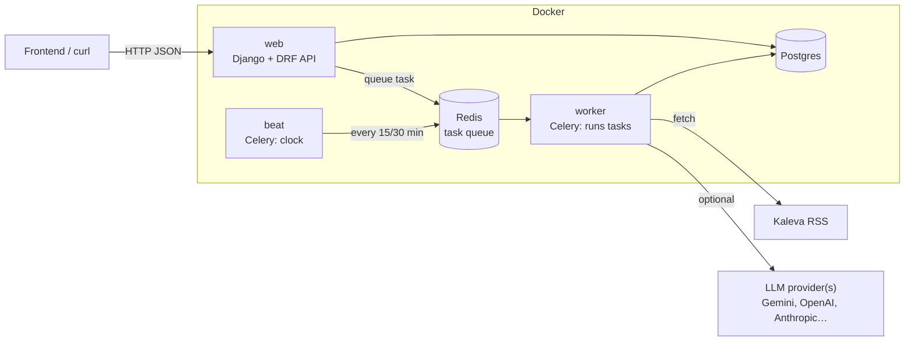
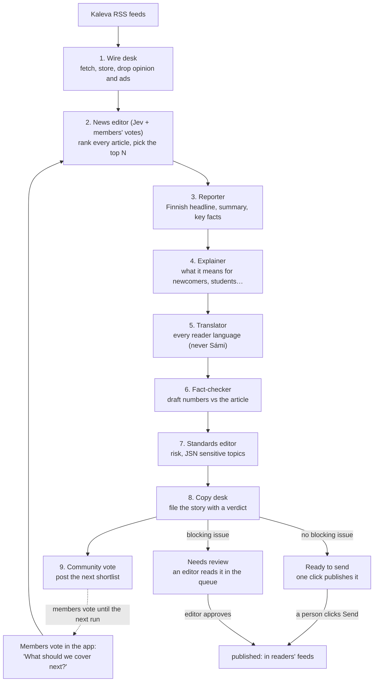
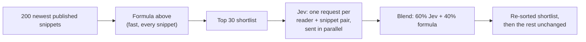

# Team guide: how this project works

This guide explains the backend: how to run it, how a news story moves from an
RSS feed to a reader's phone, and where each piece of logic lives. Read it top
to bottom once; after that, use the headings as a reference.

- **Requirements:** the FRS document (FR-1 … FR-5). FR numbers appear in code docstrings, so you can `grep FR-3.7` to find where a requirement is implemented.
- **Model contract:** [ARCHITECTURE.md](ARCHITECTURE.md) lists every model and field name.

---

## 1. What we are building

A local news app for a community (we seed **Oulu**). AI agents read local news
sources such as Kaleva's RSS feeds, write short "snippet" cards in Finnish, explain
what each story means for newcomers, students and seasonal workers, and translate
it. **Nothing reaches readers until a human editor approves it.** Around that
core there are community boards, crowd-sourced fact-check notes, and a sports
prediction game that uses virtual points only.

This repo is the **backend only**: a REST API with no web pages for readers.
A frontend (the swipeable feed) still needs to be built against
`http://localhost:8000/api/`.

---

## 2. Getting it running

### Option A: Docker (recommended, same for everyone)

You need Docker Desktop (Mac/Windows) or Docker Engine with the compose plugin (Linux).

```bash
git clone <repo> && cd junction-oulu-2026
docker compose up --build -d
```

That's all. On every start, a one-shot `setup` container runs `manage.py bootstrap`, then exits:
1. It migrates the database.
2. It loads the demo data (Oulu and 6 topic communities, markets, demo readers, and 20 Community News posts by six neighbours in Finnish, English, Swedish, Ukrainian and Arabic, with replies, likes and shares: `DEMO_POSTS` and `DEMO_REPLIES` in `bootstrap.py`; missing ones are added on every start) and creates an admin user.
3. **On the first start only**, it imports the Liiga season from the Liiga API and creates the Fantasy Liiga demo managers and leagues. This needs internet and takes about 3 minutes. Later starts skip it, taking a couple of seconds. Set `SEED_FANTASY=false` in `.env` to skip it entirely.

Web, worker and beat start only after `setup` succeeds, so they always see a migrated, seeded database. Follow the first start with `docker compose logs -f setup`.

| URL | What |
|---|---|
| http://localhost:5173 | **Reader app** (React + Vite, `frontend/`): onboarding, personalised feed in the reader's language, stories with the Finnish original, saved, profile. See `frontend/README.md`. |
| http://localhost:8000/ | **Newsroom Admin** dashboard (`backend/frontend/index.html`, staff login). It has five sections:<br>• **Overview:** queue counts, checklist items to confirm, reported posts, runs, the schedule with the next run and a "Run now" button, and model status (checked against the Ollama server).<br>• **Editor queue:** stories and translations with the AI's flags and the JSN checklist. Edit text before approving (also how Sámi text is written), approve, request changes, reject, or batch-approve low-risk items.<br>• **Community:** reported posts with the reasons, and Keep or Remove; **Unanswered questions** from members, where you link the story that answers each; the removed and kept history.<br>• **AI newsroom:** Run now (choose how many stories) and a live view of the latest or any earlier run: every desk's progress, every story's Jev score, stage and verdict (Ready to send with a Send button, or Needs review with the reasons), plus what the wire desk fetched and what Jev ranked highest (§4–5).<br>• **Compare feeds:** up to 3 real readers side by side, exactly as each gets the feed (`/api/feed/snippets/?as_user=<id>`, staff only). |
| http://localhost:8000/api/docs/ | Interactive API docs (Swagger). Try any endpoint here. |
| http://localhost:8000/admin/ | Django admin. Log in with `admin@example.com` / `admin`. |

Demo accounts created by `bootstrap` (local dev only; the dev UI has one-click buttons for them):

| Account | Password | Profile |
|---|---|---|
| `admin@example.com` | `admin` | Superuser, can review everything |
| `newcomer@example.com` | `demo-reader` | Newcomer who arrived 5 days ago; interests housing, work, health, services |
| `fan@example.com` | `demo-reader` | Long-time resident; interests sports, culture, events |

**Try the whole flow in the dev UI:**
1. Click **Editor (admin)**, then go to **AI newsroom** → *Run pipeline*.
2. Go to **Editor queue** and approve a few snippets. Approving an editor task publishes the Finnish version. For English, switch the filter to *Translation tasks* and approve the `en` ones too.
3. Go to **Compare readers** → *Load both feeds*. With a `TYPESAFE_API_KEY` set, the two readers get different orders, and each card shows Jev's reasons.

Useful commands (or use `make up`, `make logs`, `make down`; run `make help` for the full list):

```bash
docker compose logs -f web worker      # watch what's happening
docker compose exec web python manage.py run_pipeline --stories 3   # run the AI newsroom once
docker compose exec web python manage.py shell               # Python shell with Django loaded
docker compose down                    # stop (keeps data)
docker compose down -v                 # stop AND wipe the database
```

You only need `.env` to change settings (for example to add an LLM API key):
`cp .env.example .env`, edit it, then run `docker compose up -d` again.

### Option B: Local Python, no Docker

Needs Python 3.13. This uses SQLite, and tasks run inline, so you don't need
Postgres or Redis.

```bash
cp .env.example .env
python3 -m venv .venv
.venv/bin/pip install -r backend/requirements.txt     # Windows: .venv\Scripts\pip ...
cd backend
../.venv/bin/python manage.py bootstrap                # migrate + demo data + admin user
../.venv/bin/python manage.py runserver
```

### Troubleshooting

| Symptom | Cause / fix |
|---|---|
| `address already in use` on 5433 / 6380 / 8000 | Another program uses that port. Change the left-hand number under `ports:` in `docker-compose.yml`. |
| `setup` exited with an error | `docker compose logs setup` shows why. Usually a migration problem after pulling new code; `docker compose down -v` gives you a fresh database. |
| `run_pipeline` reports 0 stories | The wire desk only offers articles from the last 48 h that no story was written from yet. Wait for new articles, or `docker compose down -v` to start over. |
| Translations look like `[en] Finnish text…` | That agent is on the offline stub: `LLM_MODEL` empty, no `LLM_API_KEY`, or the provider's package isn't installed. `manage.py llm_check` says which (§5). |
| Newsroom runs fine but text still looks stubbed, with a key set | The run's errors (admin → Agents → Agent runs → state) and `docker compose logs worker` show the Gemini error. Usually a wrong key or `LLM_MODEL` name; after editing `.env`, run `docker compose up -d`. |
| Newsroom is very slow with Ollama | Local models on a CPU take minutes per story. Use a smaller model (`qwen3:4b`, `qwen3:1.7b`), a GPU (§5), or fewer stories per run (`AGENT_MAX_ITEMS`). |
| `llm_check` says Ollama has no model | Download it once: `docker compose exec ollama ollama pull <model>`. |

Ports on your machine: API **8000**, Postgres **5433** (user/pass/db `junction`), Redis **6380**.

---

## 3. The big picture



- **web** answers HTTP requests. It never runs the slow AI pipeline itself; it queues a task.
- **beat** is a clock. It queues scheduled jobs from `backend/config/celery.py`:
  - ingest news: every 30 min
  - expire old snippets: every 15 min
  - settle finished sports events: every 5 min
- **worker** picks jobs off Redis and runs them (the LangGraph pipeline, expiry, settlement).
- **Postgres** stores everything. **Redis** is only the job queue.

### Code layout

```
backend/
  config/            settings.py (all config), urls.py (routes), celery.py (schedule)
  apps/
    common/          shared enums (languages, risk tiers…), base model, permissions, bootstrap command
    accounts/        users, profiles, onboarding, roles
    communities/     communities, posts, contributions, sources, glossary, context library
    feed/            snippets, per-language versions, the feed API, ranking
    agents/          the LangGraph AI newsroom
    editorial/       human review queue, approval rules, audit log, corrections
    notes/           Community Notes
    markets/         prediction markets and the virtual-points ledger
```

Every app follows the same pattern, so once you know one you know them all:

| File | Holds |
|---|---|
| `models.py` | Database tables |
| `services.py` (or `services/`) | **Business logic.** Plain Python functions. Put rules here, not in views. |
| `serializers.py` | Model ↔ JSON |
| `views.py` | HTTP endpoints. Thin: validate input, call a service, return JSON. |
| `urls.py` | Mounted at `/api/<app>/` |
| `admin.py` | Django admin screens |

Apps refer to each other's models by string (`"feed.Snippet"`) to avoid circular imports.

---

## 4. The AI newsroom: from Kaleva to a reader

This is the most important section. A newsroom **run** (a shift) works like a real newsroom: desks
hand the work on, and people decide what goes out.



Step by step, with the code location (`backend/apps/agents/newsroom/`):

1. **Start.** Every `AGENT_SCHEDULE_MINUTES` (30) `beat` starts a run with `AGENT_MAX_ITEMS` stories; or press **Run now** on the dashboard's AI newsroom page and choose how many; or `manage.py run_pipeline --stories 3`. Only one run goes at a time. Each run is an `AgentRun` (`tasks.run_newsroom` → `runner.run_newsroom`).
2. **Wire desk** (`wire.py`) fetches one fixed feed, Kaleva's free articles (`KALEVA_FEED_URL` in `wire.py`: `https://www.kaleva.fi/feedit/rss/managed-listing/rss-maksuttomat/`). It is not read from the database. New or changed articles become `SourceDocument`s (duplicates skipped by content hash). Each gets a lead picture, `SourceDocument.image_url`: the RSS entry's own image (enclosure, `media:` tags or an `` in its HTML), else the article page's `og:image`/`twitter:image`. Pictures are hotlinked, not copied. The reader app shows them on the For You feed, story page and cards (a picture an editor uploads to `Snippet.image` wins). For stories made before this, run `manage.py backfill_images`. Candidates are the last 48 h of stored articles nothing was written from yet, minus opinion pieces and paid content (JSN 11/16).
3. **News editor** (`news_editor.py`) asks **Jev** about every candidate, adds **members' votes** (see below) and keeps the top N. Each pick becomes a `RunStory` with its score and reasons, e.g. "3 members voted for it (67 % of residents)".
4. **Each story goes desk by desk** through a small LangGraph (`runner.story_graph`): reporter → explainer → translator → fact-checker → standards editor → copy desk (`desks.py`, `copy_desk.py`). Every desk records where it is (`RunStory.stage`, e.g. "translator: Ukrainian (3 of 7)") and what it did (`AgentStep`). That is what the dashboard shows live. A story that breaks is marked failed; the others go on.
5. **Copy desk** saves the `Snippet` and one `SnippetVersion` per language, the check results the editor queue shows, any JSN checklist items, and opens the `ReviewTask`s. It sets the **verdict** (`Snippet.review_level`, with `review_reasons`):
   - **Ready to send:** no blocking issue. A person publishes it with one click (`POST /api/agents/runs/<id>/send/`), alone or with "Send all ready". Their name goes on every approval and in the audit log (`sent_without_review`).
   - **Needs review:** at least one blocking issue, listed on the story. An editor reads it in the Editor queue and approves it there (§6).
6. **Community vote** (`shortlist.py`): after the stories, the best articles the newsroom did *not* cover go on the shortlist (`CoverageCandidate`, 10 at a time; stories members already voted for stay on). Titles are machine-translated, one model call per language. Members vote in the reader app (Discover → "What should we cover next?"), and the next run counts the votes. Stories that get covered move to "You voted, we covered it", with a link once published.
7. **Feed.** `GET /api/feed/snippets/` shows only published, unexpired stories, each reader in their own language. After that, reports reopen a story, `review_by` brings it back to an editor, and `expires_at` retires it.

**What makes a story "Needs review"** (blocking issues):
- The AI reporter failed, so the draft is just the article's first sentences.
- The draft has a number the article doesn't (the fact-checker compares numbers; "24. lokakuuta" counts as 24.10.).
- A high-stakes topic: residence permits, health, legal matters, safety (`RISK_KEYWORDS` in `graph/text.py`).
- A JSN sensitive topic: crime or suspicion, right of reply, minors, illness or death (`apps/editorial/checklist.py`). The editor must tick each one before approving.

Notes that don't block: a translation that came back in the wrong language (it's left out, and those readers see English or Finnish), a translation that may have lost a number, a missing "what this means for you", a sensational-looking headline, Sámi (always left to a human translator).

---

## 5. The desks, one by one

| # | Desk | Who does it | What it does | Human counterpart |
|---|---|---|---|---|
| 1 | Wire desk | Kaleva RSS | Fetches every active feed, stores new and changed articles, sets aside opinion and paid content. | Editors choosing the feeds |
| 2 | News editor | **Jev** + members' votes | Ranks every candidate for this community's readers, adds the community's votes and picks the top N. | News editor |
| 3 | Reporter | AI model | Finnish headline (under 100 characters), 2–3 sentence summary, 2–5 key facts, only from the article. | Editor |
| 4 | Explainer | AI model | One or two sentences per reader situation (newcomer, seasonal worker, student, resident). | Editor |
| 5 | Translator | AI model | Every language of the community and of its members, one call per language. A translation in the wrong language (checked by script, Ukrainian vs Russian letters and common words) or still in Finnish is left out. Never Sámi. | Language reviewer |
| 6 | Fact-checker | rules | Every number in the draft must be in the article; translations should keep them. | Editor |
| 7 | Standards editor | rules | Risk tier and JSN sensitive topics. | Standards editor |
| 8 | Copy desk | rules | Files the story: Ready to send or Needs review, with reasons. | Editors |
| 9 | Community vote | members, in the app | Posts the next shortlist with translated titles; members vote on what the newsroom covers next. | The community |

**Jev picks the news.** `news_editor.py` sends Jev the community's readership (town, share of each reader situation, top interests, languages: never anything about a person) and one article, with four questions:

```
score = 0.30 × is it about the town or its region?          (yes/no)
      + 0.30 × does it affect people living there?           (yes/no)
      + 0.15 × can a reader act on it?                       (yes/no)
      + 0.25 × how newsworthy is it? (0–3, scaled to 0–1)
```

Answers are cached per article. Without `TYPESAFE_API_KEY`, or when Jev fails for an article, a heuristic scores it (local, fresh, a topic readers follow). Jev also still ranks each reader's For You feed (§7).

**The community decides with Jev** (`community_votes()` in `news_editor.py`). Each story's final score is

```
score = Jev's score (0–1) + VOTE_WEIGHT (1.0) × vote strength (0–1)
vote strength = the largest share of any one reader group (newcomers, students, seasonal workers, residents) that voted for it
```

Measuring by group means a small group that strongly backs a story counts as much as a large one, so the biggest group can't decide everything. A group counts as at least 3 people (`MIN_GROUP`), so one vote isn't "100 %". With weight 1.0, a story a whole group backs outranks anything Jev alone would pick. Votes come from members of any community; one vote per member and story (`POST`/`DELETE /api/agents/shortlist/<id>/vote/`). Votes set what gets covered; editors still decide what is published.

**Small models.** Every model call asks for a small JSON object as plain text and parses it leniently (code fences, text around it, trailing commas), with one retry (`newsroom/ai.py`). For Ollama, the model's separate "thinking" output is switched off, so reasoning models like qwen3 answer directly.

**The live view.** The admin dashboard's **AI newsroom** page shows the latest run (or any earlier one) and refreshes every 2 s while it runs:
- every desk: done, working now (and on which story) or waiting, who does it, progress and time;
- every story: its Jev score and why, how far through the desks it is, and its verdict with reasons, with **Send** for ready stories and **Review** for the rest;
- what the wire desk fetched and what Jev ranked highest.

### The AI model: any provider, three lines in `.env`

The newsroom is model-agnostic: `graph/llm.py` builds the model with LangChain's `init_chat_model`, so any provider LangChain supports works. To choose one, set three lines in `.env`:

```bash
LLM_PROVIDER=groq
LLM_MODEL=llama-3.3-70b-versatile
LLM_API_KEY=gsk_...
```

Switching provider means changing those three lines, then running `docker compose up -d`:

| `LLM_PROVIDER` | Example `LLM_MODEL` | Key from |
|---|---|---|
| `groq` | `llama-3.3-70b-versatile` | console.groq.com/keys |
| `gemini` | `gemini-3.1-flash-lite`, `gemini-3.8-flash` | aistudio.google.com/apikey |
| `openai` | `gpt-5.5-mini` | platform.openai.com |
| `anthropic` (or `claude`) | `claude-haiku-5-5` | console.anthropic.com |
| `mistral`, `openrouter`, `deepseek`, `xai`, `together`, `fireworks` | that provider's model name | that provider |
| `ollama` (local, no key) | `qwen3:4b` (CPU-friendly), `qwen3.8:27b` (GPU / ~20 GB RAM) | runs in Docker, see *Local models with Ollama* |

- **Ollama, Groq, Gemini, OpenAI and Anthropic work out of the box.** For any other provider, add its `langchain-<provider>` package to `backend/requirements.txt`. `llm_check` tells you if it's missing.
- **OpenAI-compatible servers** (vLLM, LM Studio, a LiteLLM proxy, a hackathon endpoint): `LLM_PROVIDER=openai`, `LLM_MODEL=<model>`, `LLM_BASE_URL=http://…/v1`. The key is optional.
- **Structured output** is picked per provider: tool calling for Groq, native JSON schema for the others. To force one, set `LLM_STRUCTURED_OUTPUT=function_calling` or `json_schema`.
- **Leave `LLM_MODEL` empty** (or set it to `stub`) to run without any AI provider (see below).

**Check your setup:**

```bash
docker compose exec worker python manage.py llm_check          # model per agent, and whether it's ready
docker compose exec worker python manage.py llm_check --ping   # plus one tiny real call
```

If something is missing, it says so: no key, unknown provider, or a package that isn't installed.

**Advanced: a different model for one agent.** Normally every agent uses the model above. To give one agent its own, add a line with `provider:model`. That provider's key then comes from its own variable, unless it's the same provider as `LLM_PROVIDER`:

```bash
LLM_MODEL_TRANSLATOR=anthropic:claude-haiku-5-5
ANTHROPIC_API_KEY=sk-ant-...
```

The desks that call a model are `REPORTER`, `EXPLAINER` and `TRANSLATOR` (e.g. `LLM_MODEL_TRANSLATOR`). Per-provider key variables: `GEMINI_API_KEY`, `OPENAI_API_KEY`, `ANTHROPIC_API_KEY`, `GROQ_API_KEY`, `OPENROUTER_API_KEY`, `MISTRAL_API_KEY` and so on (`LLM_PROVIDER_KEY_VARS` in `config/settings.py`).

**No model or no key → the offline stub.** An agent without a usable model runs a deterministic **stub** instead of AI:
- Headlines come from the RSS title, facts from sentences that contain numbers, and risk from keywords.
- "Translations" are just the Finnish text with an `[en]` prefix.

The stub keeps the whole flow working offline, in tests and at demos without spending tokens. If a real model errors mid-run, that agent falls back to the stub for that item, and the run continues.

**Local models with Ollama.** Ollama runs open models (Qwen, Llama, Gemma …) on your own machine, with no API key, no quota and no cost per call. It's included as an optional Docker service:

```bash
# .env
LLM_PROVIDER=ollama
LLM_MODEL=qwen3:4b
COMPOSE_PROFILES=ollama      # makes `docker compose up` also start the ollama container
```

```bash
docker compose up -d
docker compose exec ollama ollama pull qwen3:4b                 # download the model once (kept in a volume)
docker compose exec worker python manage.py llm_check --ping    # confirm it answers
```

- **Pick a model that fits your hardware.**
  - On a laptop CPU with 8 GB RAM, use a small model like `qwen3:4b` or `qwen3:1.7b`. It works but is slow: minutes per story.
  - `qwen3.8:27b` needs a GPU or about 20 GB of free RAM. For a GPU, uncomment the `deploy:` block of the `ollama` service in `docker-compose.yml` (needs the NVIDIA Container Toolkit).
- **Ollama on another computer** (e.g. a GPU box on your network): leave `COMPOSE_PROFILES` empty and set `LLM_BASE_URL=http://<its-ip>:11434`. On that computer:
  - Make Ollama listen on the network, not just localhost. Its default is localhost only. For the systemd service, run `sudo systemctl edit ollama`, add `Environment="OLLAMA_HOST=0.0.0.0:11434"` under `[Service]`, then `sudo systemctl restart ollama`. When starting it by hand: `OLLAMA_HOST=0.0.0.0:11434 ollama serve`.
  - Open port 11434 in its firewall (`sudo ufw allow 11434/tcp`, or the cloud provider's security group).
  - Check with `curl http://<its-ip>:11434/api/tags`. It should list your models.
  - Anyone who can reach that port can use the server, so keep it on a trusted network.
- **Ollama on this same computer:** set `LLM_BASE_URL=http://host.docker.internal:11434`, and start Ollama with `OLLAMA_HOST=0.0.0.0` so the containers can reach it.
- **Without Docker** (`manage.py runserver`), Ollama is expected at `localhost:11434`.
- **`llm_check` warns** if the configured model hasn't been pulled yet, or if Ollama can't be reached.

**Tuning for small models** (optional, in `.env`):
- `LLM_LANGUAGES_PER_CALL` is **1 by default**: each language is translated, and back-translated, in its own call. Small models mix up languages when asked for several at once. In testing, a 2B model filed Swedish as English and Russian as Ukrainian. Set `0` (all languages in one call) only for large hosted models.
- `LLM_MAX_OUTPUT_TOKENS` caps the length of each answer.
- `AGENT_MAX_ITEMS` and `AGENT_SCHEDULE_MINUTES` set how many stories each run handles, and how often runs happen. Each story costs about 5 model calls.

**Structured output** uses each provider's native JSON-schema mode. If a model refuses it with a 400 error, that call is retried once with tool calling. (Qwen on Groq sometimes misnames the tool in tool-calling mode, so JSON schema is the reliable choice there.)

---

## 6. Editorial rules: who must approve what

The newsroom follows the [Journalist's Guidelines](https://jsn.fi/en/journalists-guidelines/) of the Council for Mass Media in Finland (JSN). **A human always decides.** Agents only draft, and nothing reaches readers without these approvals. All in `apps/editorial/services.py`; the pure rule is `requirements_for(tier, languages)`.

| What | Who must approve |
|---|---|
| The story (Finnish original) | 1 editor, at every risk tier |
| **Every translated version** | 1 language reviewer **for that language**, at every risk tier: an editor can't vouch for an Arabic text they can't read (FR-3.9, JSN 9) |

The risk tier still sets queue priority, expiry, and whether low-risk stories can be approved in a batch (`POST /api/editorial/tasks/batch-approve/`).

**Gates before anything is drafted or published:**

| Gate | Guideline | How |
|---|---|---|
| **News only** | JSN 11 (fact vs. opinion), 16 (hidden advertising) | `classify_content()` in `graph/text.py` recognises reviews ("Arvio:"), columns, editorials, opinion pieces and sponsored or commercial content. These are excluded before drafting, and the run's state lists them under `excluded`. The assignment model can also exclude an item, but never let one back in. The standards check fails any draft that still reads as opinion or advertising. |
| **Sensitive-topic checklist** | JSN 21–22 (right of reply), 27/32 (minors), 25/28/33 (illness, death, victims), 30–32 (crime) | `apps/editorial/checklist.py` detects these topics in the source and draft (Finnish and English). Each one becomes a `ChecklistItem`. **The editor's approval is refused, and `can_publish()` stays false, until the editor confirms every item** (`approve` with `confirm: [keys]`, optional `notes`). Batch approval skips these stories. Each confirmation is logged with who and when. |
| **Evidence in the queue** | JSN 9, 12 | Every task in `GET /api/editorial/tasks/` has `flags`: the fact-check result and issues per language, failed standards checks with clause numbers, the checklist, and the source articles. The dev UI's editor queue shows them, with tick boxes for the checklist. |
| **No silent fallbacks** | JSN 9 | If the AI model fails and a placeholder is used instead of a translation, that version fails verification, so it can't pass as checked. |

- **Escalation:** failed fact-check or confidence < `AGENT_CONFIDENCE_THRESHOLD` (0.7) → treated as High, whatever the original tier.
- **Per-language publishing:**
  - The snippet goes live when the editor has approved it and the Finnish version is approved.
  - Each other language shows up in the feed only once *its own* reviewer approves it. Until then, readers of that language see the Finnish (or English) version.
- **Sámi (se, smn, sms):**
  - Always needs a language reviewer.
  - Machine-translated text can never be approved.
  - The empty placeholder can't be approved either: the reviewer writes the text and sends it as `edits` in the approve call.
  - A community editor of that community can veto by rejecting.
- **Queue order:**
  - Reports first (priority 90 + tier), then failed verification (80), failed standards (70), low confidence (60), then everything else.
  - Within each reason, higher risk comes first.
  - Reopened snippets get 100.
- **Audit:** every action (agent created, enqueued, approved, edited, rejected, published, reopened, expired) writes an `AuditLogEntry`. See `GET /api/editorial/snippets/{id}/audit/`.
- **Corrections:** editing an already-published snippet creates a `Correction`. That shows in the public `GET /api/editorial/corrections/` log and as `correction_note` on the card.
- **AI disclosure:** every card carries `ai_disclosure` with the agent roles that worked on it, the reviewer's name, the verification date, and whether the text is machine-translated.

### Roles

Roles are `UserRole` rows. Grant them in **admin → Users → (user) → User roles** inline. A role can be scoped to one language and/or one community; leave a scope empty to mean "all".

| Role | Can |
|---|---|
| `editor` | Approve/reject the whole snippet |
| `language_reviewer` | Approve a language version (set `language`) |
| `news_editor`, `standards_editor` | Defined, not yet required by the rules (see §13) |
| `community_editor` | See their community's queue; veto Sámi content |
| `admin` | Everything, incl. configuring sources/glossary/context via API |

Superusers (like the dev `admin@example.com`) pass every role check, which is handy for demos.

---

## 7. The feed

`apps/feed/`. The main endpoint is `GET /api/feed/snippets/` (`?community=oulu`, `?tag=health`, `?limit=&offset=`).

**Personal language (the main requirement).** Nobody picks a language in the app. Every card arrives in the reader's own language, with the Finnish original beside it:
1. **Which language:** the reader's profile language (`preferred_language`, set at onboarding). Anonymous visitors get their browser's language (`Accept-Language`).
2. **Which languages get translated:** the newsroom translates every story into the community's configured languages **plus every language its members chose in their profiles** (`load_audience_languages` in the scout). A new Somali-speaking member means stories get a Somali version from the next run on.
3. **Fallback:** a language version appears only after it's approved (§6). Until then, the reader gets English, then Finnish, and the card says so (`in_your_language: false`, `requested_language`).
4. **On every card:**
   - `original`: the Finnish headline, summary and facts, so readers can compare or show a Finnish-speaking neighbour. It's `null` for Finnish readers.
   - `for_you`: the "what this means for me" text for the reader's situation (newcomer, student …), in their language. If a translation lacks it, the original's text is used (`for_you_language` says which).

`?lang=xx` still overrides the language. It's meant for editors previewing a version, not for readers.

**Card payload** (one per snippet):

```
id, language, requested_language, in_your_language, headline, summary, key_facts[],
for_you, for_you_language, situation, explainer{situation: text}, background,
original{language, headline, summary, key_facts} | null,
image_url, source_urls[], author, community, tags[], reader_needs[],
published_at, verified_at, review_status, metrics{likes,shares,bookmarks,comments},
ai_disclosure{ai_generated, roles[], reviewer, verified_at, machine_translated},
correction_note, community_notes[]   ← only notes rated Helpful
ranking{ranker, score, jev…}         ← why this card is here (see "Jev" below)
```

The risk tier is deliberately **not** on the card. It's an internal editorial label (how much review a snippet needs), and "high risk" on a reader's card would read as "this news is dangerous". Editors see it in the review queue (`GET /api/editorial/tasks/`).

**Ranking** (`apps/feed/recommend.py`, FR-2.3). The newest 200 published snippets are scored, and each gets:

```
score = 0.40 × interest match      (user's interest weights vs snippet tags)
      + 0.25 × geo relevance       (member of snippet's community = 1, location inside its area = 0.7)
      + 0.20 × engagement          (read-through rate, expand taps, likes in the last 7 days)
      + 0.15 × freshness           (halves every 48 h)
```

The weights are constants at the top of the file, so tune them freely.

### Jev: AI ranking per reader

When `TYPESAFE_API_KEY` is set, [Jev](https://docs.typesafe.ai/) re-ranks the top of the feed for each signed-in reader (`apps/feed/jev.py`). Jev is TypeSafe AI's model for fast structured decisions: it doesn't write text, it returns probabilities for questions you define, in roughly 0.1–0.5 s.



Each request sends Jev a **state**: the reader's profile and the snippet. It asks four small questions about them:

| Question | Type | Weight |
|---|---|---|
| `affects_reader`: does this news directly affect this reader's life, rights, money, health or plans? | yes/no probability (Noul) | 45% |
| `matches_interests`: is it about one of their interests? | Noul | 25% |
| `needs_action`: is there a deadline, registration or event they could act on? | Noul | 15% |
| `urgency`: not time-sensitive / this month / this week / today | 4-level Score | 15% |

`combine()` turns the four answers into a 0–1 relevance score using the weights above. Tune them in code, not in prompts. The final score is `JEV_WEIGHT × Jev + (1 − JEV_WEIGHT) × formula`.

- **Fallback:** Jev never breaks the feed. A missing key, an anonymous reader, a timeout (`JEV_TIMEOUT`) or an error means that snippet keeps its formula score.
- **Cost and speed:**
  - Answers are cached per reader profile and snippet version for 6 hours (`JEV_CACHE_SECONDS`), so scrolling and re-opening the app don't repeat calls.
  - The cache key includes the profile, so changing interests or situation triggers fresh answers.
  - Only the top `JEV_TOP_K` (30) are sent.
- **"Why am I seeing this?":** every card has a `ranking` field. The frontend can show it to the reader (for example "Affects you: 92%").

  ```json
  "ranking": {"ranker": "jev", "score": 0.71, "jev_relevance": 0.83,
              "jev": {"affects_reader": 0.92, "matches_interests": 0.4, "needs_action": 0.88, "urgency": 2.1}}
  ```

  Without Jev it is `{"ranker": "heuristic", "score": …}`.
- **Privacy:** Jev receives only the reader's situation, language, days since arrival, interest names, and community/municipality names. It never receives name, email, user id or coordinates (`reader_state()`). TypeSafe is an external US-based service, so mention it in the privacy notice before a public launch.
- **Changing the questions:** edit `questions()` and `combine()` in `jev.py`. Keep each question small and specific; the TypeSafe docs recommend several atomic questions over one big one. You can try questions in the [TypeSafe Playground](https://console.typesafe.ai/playground) first.

**Interactions:** `POST /api/feed/snippets/{id}/interact/` with `{"kind": "like" | "unlike" | "bookmark" | "unbookmark" | "share" | "expand" | "read_through" | "view"}`.
- The frontend should send `view` when a card is shown, `expand` when it's tapped open, and `read_through` when the user reaches the end.
- These events feed the ranking.

**Comments:** `GET/POST /api/feed/snippets/{id}/comments/` (threaded via `parent`).
**Report as wrong or outdated:** `POST /api/feed/snippets/{id}/report/`.

**Arrival sequence** (`GET /api/feed/arrival/`, FR-3.11): for users with an `arrival_date`, it returns reviewed snippets tagged for the first 48 hours, first week or first month, based on how many days ago they arrived.

---

## 8. Users, onboarding and communities

**Accounts** (`apps/accounts/`). Users log in with **email** (no username).

| Endpoint | What |
|---|---|
| `POST /api/accounts/register/` | `{email, username, password}`. The username (3–30 letters, digits, `_` or `.`, unique regardless of case) is the member's public handle, shown as @username on posts, comments and leaderboards; sign-in stays by email. Accounts made without one (Google sign-in, admin, demo data) get one from their email, changeable via `PATCH /api/accounts/me/ {username}` (Profile → Username). |
| `POST /api/auth/token/` | `{email, password}` → `{access, refresh}` JWT. Send `Authorization: Bearer <access>`. |
| `POST /api/accounts/onboarding/` | Interests (slugs), location, `preferred_language`, `reader_situation`, optional `arrival_date`, optional `onboarding_code` |
| `GET /api/accounts/onboarding-link/<code>/` | Resolve a QR code (e.g. `OULU-WELCOME`), which presets the community, language and arrival date |
| `GET/PATCH /api/accounts/me/` | Own profile |

Google login is wired through django-allauth at `/accounts/google/login/` once `GOOGLE_CLIENT_ID/SECRET` are set.

**Communities** (`apps/communities/`):
- **Groups:** `groups/`, `groups/{slug}/join/`, `groups/{slug}/leave/`.
  - **Geographic** (`kind=geo`, e.g. Oulu): has its own newsroom sources and runs.
  - **Topic** (`kind=topic`, e.g. "New in Oulu", "Students in Oulu", "Kärpät & sports"): a place for people with something in common. It has no sources of its own; questions and tips posted there go to the geographic community of the same `municipality` (`services.newsroom_for`), so the Oulu newsroom answers them.
- **Recommended communities:** `GET groups/recommended/` ranks communities the reader hasn't joined against their profile (`services.recommend_communities`). Each result carries `reasons` the app shows, e.g. "For students", "You follow Housing, Work".
  - Where they live: +3 for the town community (by location, or by default when no location is set).
  - Their situation: +2 if it's in the community's `audiences` (newcomer, student, seasonal worker, resident).
  - Shared topics: +1.5 for each interest they follow that the community lists in `interests`.
  - Their language: +0.5 if members read it (shown only for languages other than Finnish and English).
  - A small bonus for size breaks ties.
  - The last onboarding step shows these, with those scoring 3 or more pre-selected, and joins the ones the reader keeps. Profile → Communities shows yours, the suggestions and the rest, with Join and Leave.
- **Member-only boards:** `groups/{slug}/posts/`.
- **Reader contributions:** `contributions/` (question, topic suggestion, tip, bridge story).
  - Repeated questions are merged and counted; after 3 repeats one becomes a story candidate.
  - Contributions feed the scout as signals and are **never** published automatically.
- **Feedback prompts:** "what was useful / missing".
- **Community News (posts by members, JSN annex):**
  - Posts appear at once, labelled as not reviewed by editors.
  - `POST …/posts/<id>/flag/` reports a post. It's hidden from everyone but its author until a moderator decides.
  - Moderators (community editors of that community, editors, admins) see flagged posts in `GET /api/communities/moderation/` (the dashboard's Community section) and decide with `POST …/moderation/<id>/decide/` `{decision: keep|remove, note}`.
  - Only moderators can post announcements.
  - `GET /api/communities/news/` lists the posts from all of a reader's communities. Each post carries `like_count`, `liked`, `reply_count` (visible replies) and `share_count`.
  - **Likes, comments, shares:** `POST …/posts/<id>/like/` likes a post or reply, and `DELETE` on the same URL unlikes it. `POST …/posts/<id>/share/` counts a share. Comments are replies: `GET …/posts/?parent=<id>` returns the whole thread oldest first, and `POST …/posts/ {body, parent}` adds one. Replies are translated, can be reported and are moderated like posts.
  - **Auto-translated:** after a post is saved, the `translate_post` Celery task (`apps/communities/tasks.py`) translates it into every language the community reads (`CommunityGroup.languages` plus members' profile languages, never Sámi), one model call per language. A translation is stored as a `PostTranslation` only if it passes the same language check as stories. Readers get `translation` `{language, text, from_language}` in their own language, and the app labels it "Auto-translated from X · Show original". With no working model nothing is stored and readers see the original.
  - **Answered by the newsroom:** a top-level post containing "?" is also recorded as a question `CommunityContribution` (merged with repeats, so it counts toward a story). It shows up in the dashboard's Community → **Unanswered questions**, where a moderator links the story that answers it (`POST /api/communities/news/<id>/answer/ {snippet}`). Once that story is published, the post shows "Answered by the newsroom" with the headline in the reader's language, and the question is marked answered. Publishing a story that a question already links to marks it answered too.
  - `manage.py register_posts` backfills language, question links and translations for posts created before this existed.

**Adding a new community, town or language needs no code (FR-3.14).** In admin, or via the admin-only API:
1. Create a `CommunityGroup` with its slug, map area (`bbox`) and `languages`. For it to be recommended, also fill `description`, `interests` and `audiences` (empty `audiences` = anyone).
2. Nothing to add for news: the newsroom always reads the fixed Kaleva feed in `wire.py` (`SourceFeed` rows are ignored).
3. Add `GlossaryTerm`s and `ContextEntry`s (background articles that a human wrote and reviewed).
4. Give reviewers `UserRole`s scoped to it.

The next scheduled run picks it up.

The seed (`manage.py seed_demo`) creates Oulu and 6 topic communities in Oulu (`TOPIC_COMMUNITIES`), 10 interests, 4 QR onboarding codes, 6 glossary terms and 3 placeholder context entries.

---

## 9. Community Notes (`apps/notes/`)

Any logged-in user can attach a fact-check note to a snippet or post (`POST /api/notes/notes/`). A note needs a claim summary, context, and at least one citation URL. Others rate it at `POST /api/notes/notes/{id}/rate/` with `{"value": "helpful" | "somewhat_helpful" | "not_helpful", "tags": [...]}`.

Status rule (`services.status_from_ratings`):
- Fewer than 5 ratings → *needs more ratings*.
- Average score (helpful = 1, somewhat = 0.5, not = 0) ≤ 0.3 → *not helpful*.
- Average ≥ 0.7, **and** the positive raters come from at least 2 different communities → *helpful*. Only helpful notes appear on feed cards.

The "different communities" check is a simple stand-in for X's bridging algorithm; there is a TODO to upgrade it.

---

## 10. Sports prediction markets (`apps/markets/`)

**Virtual points only.** There are no deposits, withdrawals or cash, because real money would make this gambling.

- **Binary markets** (Kalshi-style), e.g. "Kärpät wins?":
  - Buy YES or NO at a price between 0.01 and 1.00.
  - Stake = price × quantity.
  - If you're right you get 1.00 per contract.
- **Fantasy contests** (Dream11-style):
  - Pick a roster under a salary cap and pay an entry fee.
  - Player stats become points, and the top finishers split the pool (50/30/20%).
- **Ledger:** double-entry bookkeeping. Every movement is a transaction whose lines sum to exactly 0, with a "house" wallet as the other side.
  - New users get `MARKETS_SIGNUP_GRANT` (1000) points from the house on first `GET /api/markets/wallet/`.
  - All money-moving code runs inside `transaction.atomic()` and locks the wallets involved (`select_for_update`), so two simultaneous orders can't overspend.
- **Settlement:** an admin posts the final score (`POST /api/markets/events/{id}/final-score/`), or the 5-minute `settle_finished_events` task runs; either one resolves the markets and pays winners. Running it twice is safe.

`manage.py seed_markets` creates two Liiga games (Kärpät–Tappara, Ässät–Lukko) with markets and a fantasy contest.

**Storage:** uploaded files (snippet thumbnails, post images) are stored on local disk in `backend/media/` and served by Django at `/media/`. In Docker, that folder is the same one on your machine (the `backend/` folder is mounted into the containers), so files survive restarts. `backend/media/` is gitignored. There is no S3 or MinIO.

---

## 10b. Fantasy Liiga (`apps/fantasy/`)

A season-long manager game in the style of Fantasy Premier League, built on real Liiga data. It is **free to play**: no entry fees, no prizes and no wallet. The rewards are the leaderboards.

**Import data** from the Liiga stats API (no key needed for reads; `LIIGAFI_API_KEY` is sent if set):

```bash
python manage.py sync_liiga            # current season (2027 = 2026-27): teams, gameweeks, games, rosters, box scores, prices (~2 min)
python manage.py sync_liiga --skip-stats   # schedule and rosters only
python manage.py seed_fantasy_demo         # demo: 30 managers since gameweek 1, scored on real stats, 2 leagues
```

`seed_fantasy_demo` replaces its demo users (`*@demo.fantasy`, password `demo1234`) each time it runs. It is local/demo only.

After that, Celery keeps the data current:
- `fantasy-sync-live`, every 10 min: box scores for games in progress, then rescoring.
- `fantasy-sync-schedule`, daily at 06:00: schedule and rosters.

**Rules** (all constants are in `apps/fantasy/rules.py`):
- **Squad:** 15 players (2 G, 5 D, 8 F), budget 100, at most 3 players per team.
- **Lineup:** each gameweek, start 11 players (1 G, 4 D, 6 F); the other 4 sit on the bench. Gameweeks are Liiga's own `gameWeek`, and the deadline is the first puck drop.
- **Captain:** scores double. If the captain doesn't play, the vice-captain scores double instead.
- **Auto-substitution:** a starter who didn't play is replaced by the first bench player of the same position, once their team has no games left that week.
- **Transfers:**
  - Unlimited before your first deadline.
  - After that, you get 1 free transfer per gameweek, banking up to 5. Each extra transfer costs 4 points.
- **Prices:** set by points-per-game rank within each position, from 4.0 to 13.0. A player's price is fixed once someone owns them.
- **Points:**
  - Goals: F 4, D 6, G 8. Assists: 3.
  - Skaters: +/−, 1 point per 3 shots and per 3 blocked shots, a bonus for 15+ minutes of ice time.
  - Defence: 3-point shutout bonus.
  - Goalies: 1 point per 5 saves, −1 per 2 goals against, win 3, shutout 5.
  - Penalties: −1 per 2 penalty minutes.

**Endpoints** (`/api/fantasy/`):

| Endpoint | What |
|---|---|
| `GET season/` | Current season, gameweeks, next deadline |
| `GET players/` | `?position=G\|D\|F&team=&search=&ordering=-total_points` |
| `GET players/{id}/games/` | Per-game points with breakdown |
| `GET fixtures/?gameweek=9` | Games in a gameweek |
| `GET/POST squad/` | Your squad / create `{name, player_ids[15]}` |
| `GET/PUT squad/lineup/` | `{starters[11], bench[4], captain, vice_captain}` for the next deadline |
| `GET/POST squad/transfers/` | History / `{"out": [ids], "in": [ids]}` |
| `GET squad/history/` | Your points per gameweek |
| `GET/POST leagues/`, `POST leagues/join/` | Private leagues with a 6-character invite code |
| `GET leaderboard/` | `?period=day\|week\|season` `&scope=global\|community\|league` `&date=` `&gameweek=` `&community=oulu` `&league=` |

**Local leaderboards:** the `community` scope ranks members of a `CommunityGroup`. Kärpät is linked to Oulu (`TEAM_COMMUNITIES` in `services/liiga.py`).

### Lämäri: prizes, analysis and the sports desk

In the reader app, the fantasy game is branded **Lämäri** (Profile > Fantasy mode > Lämäri fantasy).

**Brand prizes:**
- Brands fund prizes for leaderboard places (`Sponsor`, `Reward`). When a gameweek is final, everyone inside a weekly prize's range gets a `Voucher` with a code (`services/rewards.py`). Season prizes are awarded after the final.
- `manage.py seed_sponsors` creates the demo partners from the logos in `backend/media/fantasy/`. Bootstrap runs it automatically.
- Managers get a tier from their season rank: Diamond (the leader, plus the top 1%), Gold (top 10%), Silver (top 35%) and Bronze.

**Analysis and coaching** (`services/analysis.py`):
- Every sentence is built from Liiga data: results, standings computed the Liiga way (3/2/1 points), form, head-to-head, fantasy points.
- An AI model may reword the notes, but its version is kept only when it contains no number missing from the data.
- Readers never wait for a model. `services/reports.py` returns the data version at once and queues a background job to store an AI-worded one for the next visit.

**Sports desk agent** (`services/sports_desk.py`): every 30 minutes, Celery fetches Kaleva's hockey and sports RSS feeds once. Then each player in someone's team gets his own task, which:
- reads his Liiga game log and writes a form note;
- checks his Liiga profile for a suspension;
- stores Kaleva stories that mention him by name, with links.

**Rate limits:**
- Feeds are fetched once per cycle.
- Player tasks run at 20 per minute, with 1.5 s between Liiga requests.
- Model calls are capped at `SPORTS_AI_PER_MINUTE` (default 4) across all workers, counted in Redis.
- If the model server is down, the wording step is skipped for 5 minutes.

The model for this wording is set with `LLM_MODEL_SPORTS`; without it, the main `LLM_MODEL` is used.

**On the device:** the app keeps sports data in local storage with a time limit per kind (players 6 h, season 30 min, team 2 min). A refresh shows the stored copy instantly and only fetches what has gone stale.

| Endpoint | What |
|---|---|
| `GET rewards/` | Sponsored prizes this season |
| `GET vouchers/` | Vouchers you have won |
| `GET fixtures/{id}/analysis/?detail=short\|full` | Context beyond the score, or a preview |
| `GET squad/coach/` | Your last gameweek reviewed, with captain, lineup and transfer suggestions |
| `GET squad/news/?limit=&offset=` | What the sports desk found about your players |
| `GET managers/?q=` | Find managers by @username |
| `POST leagues/{id}/invite/` | Invite a friend by @username |
| `GET players/{id}/photo/` | 96 px player photo (WebP, cached for a week) |

---

## 11. Hands-on: the whole flow with curl

With the stack running:

```bash
# 1. Run the AI newsroom on fresh Kaleva news (takes ~10 s with the stub)
docker compose exec web python manage.py run_pipeline --stories 3

# 2. Log in as the dev admin
TOKEN=$(curl -s -X POST localhost:8000/api/auth/token/ -H 'Content-Type: application/json' \
  -d '{"email":"admin@example.com","password":"admin"}' | python3 -c 'import sys,json;print(json.load(sys.stdin)["access"])')

# 3. Look at the review queue (highest priority first)
curl -s localhost:8000/api/editorial/tasks/ -H "Authorization: Bearer $TOKEN" | python3 -m json.tool | head -40

# 4. Approve a task (use an id from step 3). Approve the editor task (language null) to publish in Finnish.
curl -s -X POST localhost:8000/api/editorial/tasks/1/approve/ -H "Authorization: Bearer $TOKEN" \
  -H 'Content-Type: application/json' -d '{}'

# 5. See it in the public feed
curl -s localhost:8000/api/feed/snippets/ -H 'Accept-Language: uk' | python3 -m json.tool | head -40   # anonymous: browser language
```

The same steps work in the Swagger UI at `/api/docs/`: click **Authorize** and paste the token.

---

## 12. Configuration reference (`.env`)

| Variable | Default | Meaning |
|---|---|---|
| `SECRET_KEY`, `DEBUG` | dev values | Django basics |
| `DATABASE_URL` | SQLite | Docker sets Postgres automatically |
| `REDIS_URL` | `redis://localhost:6379/0` | Celery queue (Docker overrides) |
| `CELERY_TASK_ALWAYS_EAGER` | `False` | `True` = run tasks inline, no worker (local mode). Docker always forces `False`. |
| `LLM_PROVIDER` | empty | `groq`, `gemini`, `openai`, `anthropic`, `mistral`, `ollama` … |
| `LLM_MODEL` | empty | The provider's model name. Empty or `stub` = offline stub |
| `LLM_API_KEY` | empty | Key for `LLM_PROVIDER` |
| `LLM_BASE_URL` | empty | OpenAI-compatible server URL (with `LLM_PROVIDER=openai`) |
| `LLM_STRUCTURED_OUTPUT` | `auto` | `function_calling` or `json_schema` to override the per-provider choice |
| `LLM_MODEL_<AGENT>` + `<PROVIDER>_API_KEY` | empty | Advanced: a different model for one agent (§5) |
| `COMPOSE_PROFILES` | empty | `ollama` starts the local Ollama container with the stack |
| `LLM_MAX_OUTPUT_TOKENS` | `0` | Cap on each call's output (0 = provider default) |
| `LLM_LANGUAGES_PER_CALL` | `1` | Languages per translation/back-translation call; `0` = all at once (large models only) |
| `LLM_MAX_RETRIES` | `2` | Retries after a failed call (hosted providers) |
| `AGENT_SCHEDULE_MINUTES` | `30` | Minutes between automatic newsroom runs. A community is skipped while its previous run is still going, and runs stuck for over 2 hours are marked failed. |
| `AGENT_MAX_ITEMS` | `4` | Stories turned into snippets per newsroom run (~5 model calls each) |
| `AGENT_CONFIDENCE_THRESHOLD` | `0.7` | Below this → escalate to High risk |
| `GOOGLE_CLIENT_ID/SECRET` | empty | Google login |
| `TYPESAFE_API_KEY` | empty | Jev feed ranking; empty = formula only. Get one at console.typesafe.ai |
| `FEED_RANKER` | `jev` | `heuristic` turns Jev off even with a key |
| `JEV_MODEL` / `JEV_TOP_K` / `JEV_WEIGHT` | `jev-latest` / `30` / `0.6` | Model, shortlist size, Jev's share of the final score |
| `JEV_TIMEOUT` / `JEV_CACHE_SECONDS` | `2.0` / `21600` | Seconds per call / cache lifetime |
| `MARKETS_SIGNUP_GRANT` | `1000` | Free points for new wallets |
| `DJANGO_SUPERUSER_EMAIL/PASSWORD` | `admin@example.com` / `admin` | Dev admin created by `bootstrap` |

---

## 13. Known gaps and good next tasks

- **Frontend:** none yet. The API is ready.
- **Remaining JSN gaps** (audited against the 2024 guidelines):
  - Corrections don't yet reach translations (35).
  - Expired or reported stories vanish instead of staying reachable with a notice (37).
  - Cards link the source but don't name the publisher (10).
  - Headlines are only checked for clickbait (15).
  - Every story is drafted from a single source (9, 12).
  - Comments and Community Notes have no moderation or flagging yet (annex L2–L4). Community posts do (§8).
  - The news-editor and standards-editor sign-offs aren't required yet.
  - Opinion detection relies on markers in the title, the start of the text or the URL. Kaleva's RSS often has only a one-line teaser, so a column without a marker can slip through to the editor, who is the final check.
- **`news_editor` and `standards_editor` approvals:** these roles exist but aren't required yet. FR-3.6 wants a news editor to approve the daily plan and a standards editor to give final sign-off; add them to `requirements_for()` if you need them.
- **Request changes:** "request changes" doesn't yet trigger the agents to redo the draft (TODO in `editorial/services.py`).
- **Recommendations:** Jev only re-ranks the top 30. The formula that builds that shortlist still uses tag overlap; switch it to embedding similarity (TODO in `recommend.py`). The embeddings are currently a hashing stub (`graph/text.py`).
- **Reports:** a single reader report unpublishes a snippet instantly. Consider a threshold.
- **Community Notes:** perspective detection is simplified (see §9).
- **Onboarding:** turning a postal code into a municipality, and auto-joining the matching community, are TODOs.
